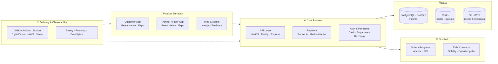

<div align="center">


<a href="https://www.exaflair.com"></a>

<br/>


<a href="https://www.exaflair.com"></a>


</div>

---

## 👋 About Me

I'm the **Chief Product Officer at [Exaflair Technologies](https://www.exaflair.com)**, where I own the path from *idea → architecture → launch → scale* across our client and in-house portfolio. I sit where **product strategy meets deep engineering**. I define what we build and why, design the systems behind it, and stay hands-on in the code, from Solana programs and Solidity contracts to NestJS services and React Native apps.

I've led **30+ products and codebases across 6 industries** (Web3, mobility, travel, real estate, commerce and energy logistics), building the roadmaps, architecture, CI/CD and teams that ship them.

```ts
class SriPardhiv extends Engineer implements ProductLeader {
  readonly role     = "Chief Product Officer @ Exaflair Technologies";
  readonly focus    = ["Product Strategy", "System Architecture", "Engineering Leadership"];
  readonly domains  = ["Web3 & Blockchain", "On-demand Mobility", "Marketplaces", "Enterprise SaaS", "Voice AI"];
  readonly stack    = { web: "Next.js", mobile: "React Native/Expo", api: "NestJS/Fastify",
                        data: "Postgres/Redis", chain: ["Solana/Anchor", "EVM/Solidity"] };

  ship(idea: Idea): Product {
    return idea
      .validateWithUsers()
      .architectForScale()
      .buildWithTeam()
      .automateDeploys()
      .measure()
      .iterate();          // repeat until product-market fit
  }
}
```

---

## 🧭 How I Lead

<table>
<tr>
<td width="33%" valign="top" align="center">

### 🎯 Product Strategy
Turn ambiguous problems into **clear roadmaps, specs and milestones**. Prioritise by user impact, cut scope ruthlessly, and run every launch in measurable phases.

</td>
<td width="33%" valign="top" align="center">

### 🏗️ Systems Architecture
Design **multi-surface platforms** (customer app, partner app, admin, API, contracts) on one data model, with real-time and on-chain layers built in from day one.

</td>
<td width="33%" valign="top" align="center">

### 👥 Engineering Leadership
Build and lead **cross-functional teams of 10+ engineers**: engineering handoffs, push-to-deploy pipelines, CI quality gates and a strong ownership culture.

</td>
</tr>
</table>

<div align="center">

| 🚀 **30+** | 🧩 **6** | 👥 **10+** | ⛓️ **2** | 💻 **270+** |
|:---:|:---:|:---:|:---:|:---:|
| products & codebases led | industries | engineers led across teams | chain ecosystems shipped on (Solana · EVM) | hands-on commits across org repos |

</div>

---

## 🧬 The Platform Blueprint I Build On

Most products I lead follow this battle-tested shape: one backend and data model serving every surface, with real-time, payments, observability and an optional on-chain layer.



---

## 🛠️ Tech Stack

<div align="center">

**Languages**


**Frontend & Mobile**


**Backend & Data**


**Web3 & Blockchain**


**AI, Real-time & Integrations**


**DevOps, Testing & Tooling**


</div>

---

## 🚀 Product Portfolio

> Products I've owned as CPO, from strategy and architecture through launch. Most are client and in-house codebases kept in private repositories, and I'm happy to walk through any of them.

### ⛓️ Web3 & Blockchain

<table>
<tr>
<td width="50%" valign="top">

#### 🏆 AwardToken (AWARD) Protocol
On-chain **reputation & proof-of-experience** on Solana. Turns verified professional achievements into portable SPL assets through an elastic *Mint-on-Merit* model, with a Next.js admin console for minting and metadata.

`Solana` `Anchor` `SPL Token` `Metaplex` `Pinata/IPFS` `Next.js`

</td>
<td width="50%" valign="top">

#### 🪂 Relyn — Airdrop-as-a-Service
A Web3 **AaaS platform** that lets token projects create, manage and distribute ERC-20 airdrops without building their own chain infra. Merkle-proof claims, a no-code campaign builder and an admin analytics panel.

`Foundry` `Ethers.js` `Merkle Trees` `Crossmint` `Supabase` `Next.js`

</td>
</tr>
<tr>
<td width="50%" valign="top">

#### 🧑‍💻 WorkChain
An **on-chain freelancer marketplace** on Solana, with escrowed jobs, wallet auth and separate client & admin dApps, backed by CI-tested Anchor programs.

`Anchor` `Solana Wallet Adapter` `InstantDB` `TanStack Query` `GitHub Actions`

</td>
<td width="50%" valign="top">

#### ⚽ GoMarket
A **fan-engagement & club token** platform: ERC-20 and club-level smart contracts, a fan portal, an admin dashboard and a backend with auto-deploy pipelines.

`Hardhat` `OpenZeppelin (Upgradeable)` `Next.js` `Express` `DigitalOcean`

</td>
</tr>
</table>

### 🛵 On-Demand Mobility & Delivery: **QOX Suite**

<table>
<tr>
<td width="50%" valign="top">

A **multi-service super-app** for rides, parcels and food/grocery delivery, built as a full product ecosystem:

- 📱 **QOX Customer**: booking, live tracking, upfront pricing
- 🏍️ **QOX Rider**: accept rides, route & status updates in real time
- 🧠 **QOX Backend**: order lifecycle, Supabase schema, sockets
- 🖥️ **Admin Panel** + 🌐 **Website**

</td>
<td width="50%" valign="top">

`Expo SDK 54` `React Native` `Firebase (Auth, FCM, Crashlytics)` `Socket.io + Redis Adapter` `Express` `Prisma` `PostgreSQL` `Supabase` `Google Maps` `Notifee` `MSG91 OTP` `GitHub Actions CD`

</td>
</tr>
</table>

### 🏨 Marketplaces & Consumer Apps

<table>
<tr>
<td width="50%" valign="top">

#### ✈️ StayVoy
Hotel discovery & booking: room availability, secure payments, trips and reviews across **mobile, web, admin and backend**.

`Expo` `Supabase` `Razorpay` `Sentry` `Jest` `CI`

</td>
<td width="50%" valign="top">

#### 🐾 Clawkind
A **trust-first pet services** platform connecting owners with verified groomers, walkers, trainers, boarders and vets, with web push and email notifications.

`React Native` `Next.js` `Supabase` `Razorpay` `Resend` `Playwright`

</td>
</tr>
<tr>
<td width="50%" valign="top">

#### 🏠 PropSearch
Full-stack **real-estate listings**: agents manage listings, users search, favourite, comment and request contact, with Google sign-in.

`Expo` `Convex` `Clerk` `Next.js` `shadcn/ui`

</td>
<td width="50%" valign="top">

#### 🛒 Cartlyst
A **real-time mobile eCommerce** app with live data sync, plus a companion web storefront.

`Expo Router` `InstantDB` `Zustand` `React Hook Form` `Framer Motion`

</td>
</tr>
</table>

### 🏢 Enterprise SaaS

<table>
<tr>
<td width="50%" valign="top">

#### ⚡ Clear Energy DMS
A **Delivery Management System** with a high-throughput NestJS + Fastify backend, PostGIS spatial routing and a role-based React 19 admin SPA.

`NestJS` `Fastify` `Prisma` `PostGIS` `Redis` `AWS S3` `TanStack Router/Query` `Vite` `Storybook`

</td>
<td width="50%" valign="top">

#### 👕 White-Label Clothing Platform
A **multi-tenant commerce platform** in a Turborepo monorepo with a NestJS backend, storefront, client admin, super admin and shared UI/DB/email packages.

`Turborepo` `NestJS` `Next.js` `Clerk` `TanStack Table` `Docker`

</td>
</tr>
</table>

### 🤖 AI, Design & Automation

<table>
<tr>
<td width="33%" valign="top">

#### 🎙️ Voice Agent
A voice-driven AI assistant that **sends emails, books calendar slots, drafts LinkedIn posts and places calls**, with a LiveKit web UI.

`Python` `Flask` `LiveKit` `Google APIs`

</td>
<td width="33%" valign="top">

#### 🎬 animit & FramerKit
Production landing pages with **WebGL animation**, video showcases and geo-aware pricing, plus a motion-first UI kit.

`Next.js` `OGL / WebGL` `Framer Motion` `Radix UI`

</td>
<td width="33%" valign="top">

#### ⏱️ Cron Scripts
Ops automation: **EVM node storage alerts**, system monitoring and HR/attendance (Jibble) jobs.

`Python` `Node.js` `node-cron`

</td>
</tr>
</table>

---

## 🏆 Leadership & Impact

<table>
<tr>
<td width="50%" valign="top">

**🧭 Product**
- Led **30+ products** from 0 → 1, covering discovery, specs, roadmap, launch and iteration
- Built complete **multi-app ecosystems** (customer, partner, admin, web and API) for mobility, travel and pet care
- Took products into **6 industries**: Web3, mobility, travel, real estate, commerce and energy logistics

</td>
<td width="50%" valign="top">

**⚙️ Engineering**
- Architected **real-time platforms** with Socket.io + Redis, PostGIS spatial routing and live tracking
- Designed and shipped **smart contracts on Solana & EVM**: token protocols, airdrops, on-chain reputation and marketplace escrow
- Standardised **push-to-deploy CI/CD** and engineering handoffs across teams of **10+ engineers**

</td>
</tr>
</table>

---

## 🤝 Let's Connect

<div align="center">

<a href="https://www.exaflair.com"></a>
<a href="https://github.com/exaflair-technologies"></a>

<br/><br/>

*Have a product to build? Let's talk.*


</div>
